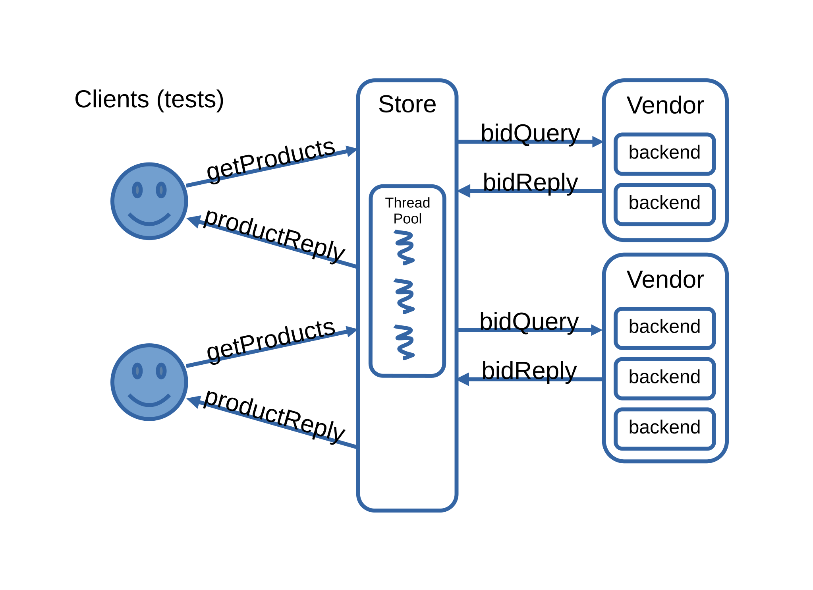

### Big Picture

  - In this project, you are going to implement major chunks of a simple distributed service using [grpc](http://www.grpc.io).
  - Learnings from this project will also help you in the next project as you will become familiar with grpc and multithreading with threadpool.
  
### Overview
  - You are going to build a store (You can think of Amazon Store!), which receives requests from different users, querying the prices offered by the different registered vendors.
  - Each vendor has one or more backend servers. On each product query, your store must contact exactly one backend per vendor and use round-robin selection for each vendor's backends.
  - Once your store has responses from all vendors, it should collate the (bid, vendor_id) pairs and send them back to the requesting client.
  - The round-robin counter is global to the store process for each vendor. It must not reset per request or per worker thread.
  -  You will also implement a thread pool. Your store will assign incoming requests to a thread which will handle the work of contacting vendors and responding to the client.
  - We have provided an implementation of the vendors and we have provided tests that simulate clients. We have also defined the RPC services and messages this system uses. All you have to do is implement the store component!
  - This project must be completed **individually**.

An overview of the system architecture is shown below:



  
### Learning outcomes
  - Synchronous and Asynchronous RPC packages
  - Building a multi-threaded store in a distributed service

## Environment Setup

To set up your environment, you can choose one of the following methods:
  - Option 1: Follow this [link](https://grpc.io/docs/languages/cpp/quickstart/) for a cmake based setup on your host machine
  - Option 2: Using Docker

### Option 2: Setting Up the Docker Environment (Skip the whole option 2 section if you choose option 1)
If you prefer to use a Docker environment for Project 3, you can either use the pre-built docker image or build and run your own image. 

#### Option 2.1: pre-built Docker image
```
docker pull murs006/aos_project3
docker run -it murs006/aos_project3
```

#### Option 2.2: Build and Run your own image (Skip this step if you use Option 2.1: the pre-built docker image)

Make sure you have Docker Desktop installed. Then follow the steps below to build your own gRPC development container.

Copy the code below into a new file named `Dockerfile` in your top-level working directory (outside of your project3_template).

```Dockerfile
FROM ubuntu:22.04
ARG DEBIAN_FRONTEND=noninteractive

RUN apt-get update && apt-get install -y --no-install-recommends \
    ca-certificates git build-essential cmake autoconf libtool pkg-config \
    unzip zip python3 \
 && update-ca-certificates

WORKDIR /tmp
RUN git clone --recurse-submodules -b v1.74.0 --depth 1 --shallow-submodules https://github.com/grpc/grpc

WORKDIR /tmp/grpc/cmake/build
RUN cmake -DgRPC_INSTALL=ON \
          -DgRPC_BUILD_TESTS=OFF \
          -DgRPC_ABSL_PROVIDER=module \
          -DgRPC_PROTOBUF_PROVIDER=module \
          -DgRPC_SSL_PROVIDER=module \
          -DgRPC_ZLIB_PROVIDER=module \
          -DCMAKE_BUILD_TYPE=Release \
          -DCMAKE_INSTALL_PREFIX=/usr/local \
          ../.. \
 && make -j 4 \
 && make install

RUN printf "/usr/local/lib\n" > /etc/ld.so.conf.d/usr-local.conf && ldconfig
RUN apt-get clean && rm -rf /var/lib/apt/lists/* /tmp/grpc

WORKDIR /workspace
CMD ["/bin/bash"]
```
Save the following in a file named `docker-compose.yml` in the same directory.

```docker
name: dev-env

services:
  dev-env:
    build:
      context: .
      dockerfile: Dockerfile
    image: dev-environment:latest
    container_name: dev-env
    tty: true
    volumes:
      - .:/workspace:rw
    working_dir: /workspace
```

Run these commands from the same folder: `docker compose up -d`. This will build the Docker image (named dev-environment:latest), and start a container named dev-env. Your current folder is mounted into /workspace inside the container. If you want to attach VS Code, open the Command Palette and choose "Dev Containers: Attach to Running Container…" and select dev-env.


## How You Are Going to Implement It ( Step-by-step )

1. Make sure you understand how GRPC- synchronous and asynchronous calls work. Understand the given helloworld [example](https://github.com/grpc/grpc/tree/master/examples/cpp/helloworld). You will be building your store with asynchronous mechanisms ONLY.
2. Establish asynchronous GRPC communication between -
    - Your store and user client. 
    - Your store and the vendors.
3. Create your thread pool and use it. Where will you use it and for what?
   Upon receiving a client request, you store will assign a thread from the thread pool to the incoming request for processing.
    - The thread will make async RPC calls to the vendors
    - The thread will await for all results to come back
    - The thread will collate the results
    - The thread will reply to the store client with the results of the call
    - Having completed the work, the thread will return to the thread pool
4. Implement round-robin load balancing across each vendor's backend list. The store-level state should track which backend to use next for each vendor.
5. Do you have your user client request reaching to the vendors now? And can you see the bids from the different vendors at your user client end? Congratulations you almost got it! Now use the test harness to test if your server can serve multiple clients concurrently and make sure that your thread handling is correct. 

## Keep In Mind
1. Your Server has to handle
    - Multiple concurrent requests from clients
    - Be stateless so far as client requests are concerned (once the client request is serviced it can forget the client)
    - Manage the connections to the client requests and the requests it makes to the 3rd party vendors.
    - Handle unavailable vendor backends gracefully: return available bids instead of failing the entire request.
2. Server will get vendor addresses from a file with sections:
    - A vendor name line (example: `Vendor A`)
    - One or more backend lines prefixed by `-` (example: `-localhost:50051`)
    - Each vendor has at least one backend.
    - Example:
      ```
      Vendor A
      -localhost:50051
      -localhost:50052
      Vendor B
      -localhost:50053
      ```
3. Your server should be able to accept `command line input` of the vendor addresses file,  `address` on which it is going to expose its service and `maximum number of threads` its threadpool should have.
4. The format of the invocation is:

        ./store <filepath for vendor addresses> \
                <ip address:port to listen on for clients> \
                <maximum number of threads in threadpool>
5. Round-robin should be true round-robin per vendor and shared across the entire store process. The first request for a vendor should use its first listed backend.
6. Remember to add references to all the resources you have used while working on the project.
 

## Given to You
  1. run_tests.cc - This will simulate real world users sending concurrent product queries.
  2. client.cc - This will be providing ability to connect to the store as a user.
  3. vendor.cc - This wil act as the server providing bids for different products. Multiple instances of it will be run listening on different ip address and port.
  4. `Two .proto files`  
    - store.proto - Comm. protocol between user(client) and store(server)  
    - vendor.proto -Comm. protocol between store(client) and vendor(server)  

## How to run the test setup
  - Go to project3 directory and build the program.
  - Three binaries would be created in the bin folder - `store`,`run_tests` and `run_vendors`. (Note that the location of bin folder depends on how you build the program.)  
  - First run the command `./run_vendors vendor_addresses.txt &` to start a process which will run multiple servers on different threads listening to (ip_address:ports) from the file given as command line argument.
  - Then start up your store which will read the same address file to know vendors' listening addresses. Also, your store should start listening on a port(for clients to connect to) given as command line argument. For instance, `./store vendor_addresses.txt localhost:8080 5`.
  - Then finally run the command `./run_tests $IP_and_port_on_which_store_is_listening $max_num_concurrent_client_requests` to start a process which will simulate real world clients sending requests at the same time.
  - This process read the queries from the file `product_query_list.txt`
  - It will send some queries and print back the results, which you can use to verify your whole system's flow.


## Project Interview

Project 3 includes a short oral interview after submission. The purpose of the interview is to verify that you understand the RPC store implementation you submitted, including its request flow, asynchronous gRPC usage, thread pool behavior, round-robin state, and failure handling. The interview is **not a second autograder** and is not intended to test memorization. You should be prepared to open your submitted code and explain how a client request moves through your store, how the major concurrency mechanisms work, and why your implementation satisfies the project requirements.

- The interview itself will take about **15 minutes** and will be scheduled in a **20-minute appointment slot**.
- You are responsible for signing up for an interview slot by the announced deadline. If none of the available slots work for you, contact the head TAs as early as possible.
- Missing the interview without a valid documented reason will result in a **zero for the project**.
- Arriving more than **5 minutes late** may result in a **25% deduction from the project grade**.
- AI tools may be used according to the course AI policy, including any required disclosure/log submission. Regardless of tool use, you are responsible for understanding all code you submit.

### How the Interview Affects Your Project Grade

The autograder and existing project-grading components determine your **base project score**. The oral interview determines a multiplier between **0 and 1**, which is applied to the entire base project score:

```text
Final Project Score = Base Project Score × Oral Interview Multiplier
```

A student who demonstrates strong understanding of the submitted implementation should receive a multiplier close to 1. Working code by itself does not guarantee a high interview multiplier if the student cannot explain the submitted design, concurrency behavior, or correctness reasoning.

### Interview Rubric

The interview will cover the following four areas. The weights below are the relative weights **within the oral interview multiplier**.

| Category | Weight | What you should be prepared to explain |
|---|---:|---|
| **A. Request Flow and Code Ownership** | 30% | The end-to-end path of a client request through your store, including where requests are accepted, work is dispatched, vendor backends are selected, bids are collected, and the final reply is sent. You should be able to connect this explanation to your submitted `store.cc`, `threadpool.h`, and any helper files. |
| **B. Async gRPC and RPC Composition** | 25% | How your store acts as an asynchronous server for clients and an asynchronous client of vendors, how vendor RPCs overlap, and how gRPC completion handling relates to your worker-thread logic. |
| **C. Threadpool and Round-Robin Correctness** | 25% | How your bounded thread pool queues and reuses workers, how the `max_threads` argument affects behavior, and how process-global per-vendor round-robin state remains correct under concurrent requests. |
| **D. Failure Handling and Response Correctness** | 20% | How your store handles unavailable vendor backends, decides which bids appear in the response, preserves vendor response information, and avoids allowing one failed backend to incorrectly fail or hang the entire client request. |

In general, **strong understanding** means that you can explain the relevant logic independently and connect your explanation directly to your submitted code. **Partial understanding** means that you understand the main idea but need prompting or are unclear on important implementation details. **Weak understanding** means that you cannot explain or locate important parts of your submitted implementation, or your explanation conflicts with the code you submitted.

### Example Question Styles

The questions below are **illustrative examples only**. They are intended to show the level and style of the interview; the actual questions and follow-up questions may differ and may be adapted to your implementation.

- "Walk us through one product request from the moment the store receives it until the final reply is sent to the client."
- "Where does asynchronous execution happen in your store, and how do the vendor RPCs overlap rather than run serially?"
- "How do your thread pool and round-robin state behave when multiple client requests arrive concurrently?"
- "Suppose one vendor backend is unavailable. What does your store do, and what should the client receive?"

You do not need to memorize a script for the interview. The best preparation is to review your own submitted code and README and make sure you understand the request path, asynchronous RPC design, shared state, concurrency behavior, and failure handling in your implementation.

---

## Grading
The existing autograder and manual project-grading components below determine the **base project score**. As described in the [Project Interview](#project-interview) section, the final project score is the base project score multiplied by the oral interview multiplier.

This project is not performance oriented; we will only test functionality and correctness.

Below is the base project rubric:

**Total Possible Score:** 12

| Score | Reason |
| ----- | ------ |
| +1 | Code compiles |
| +4 | Query output is correct |
| +2 | Threadpool management |
| +1 | `store-server` operates in `async` fashion |
| +1 | `store-client` operates in `async` fashion |
| +2 | Round-robin load balancing correctness |
| +1 | Readme |


## Deliverables
Please follow the instructions carefully. The folder you hand in must contain the following:
  - `Readme.txt` - text file containing a brief description of both your threadpool implementation and the communicaiton pipelines you have built in the store (also include anything about the project that you want to tell the TAs).
  - `CMakeLists.txt` - You might need to change it if you add more source files.
  - `Store source files` - store.cc(must) containing the source code for store management
  - `Threadpool source files` - threadpool.h(must), containing the source code for threadpool management
  - You can add supporting files too(in addition to above two), if you need to keep your code more structured, clean etc.

**Submission Directory Structure:**

      Readme.txt
      src/CMakeLists.txt
      src/store.cc
      src/threadpool.h
      src/any_additional_supporting_files.*

You must use the collect_submission.py to create the submission zip file. Submit the zip file in gradescope. You can verify your submission using the autograder in gradescope.

# FAQ
Please make sure you've read the readme and the FAQ in their entirety before you start working on the project. FAQ can be found [here](faq.md).
